# CODE_MAP — Per-File Function Reference & Data Flow

Every Python file in the project: what it does, every function's **parameters**, **return value**,
**how it works**, and **where the flow comes from and goes to**.

Companion documents: [`instructions.md`](instructions.md) (the spec),
[`instruction 2.md`](instruction%202.md) (mechanics & formulas),
[`TO_IMPLEMENT.md`](TO_IMPLEMENT.md) (gaps).

> Diagrams below are Mermaid and render directly on GitHub. In VS Code install
> *Markdown Preview Mermaid Support* to see them in the preview pane.

---

## Contents

| File | Lines | Role | Section |
|---|---|---|---|
| `constants.py` | 85 | all tunables, palette, starting values | [§1](#1-constantspy) |
| `map.py` | 312 | territory graph, hex geometry | [§2](#2-mappy) |
| `house.py` | 114 | house state, economy, inbox | [§3](#3-housepy) |
| `combat.py` | 67 | battle resolution | [§4](#4-combatpy) |
| `diplomacy.py` | 138 | alliances, trust, proposals, log | [§5](#5-diplomacypy) |
| `algorithms/bfs.py` | 24 | reachability | [§6.1](#61-algorithmsbfspy) |
| `algorithms/dfs.py` | 28 | expansion paths | [§6.2](#62-algorithmsdfspy) |
| `algorithms/astar.py` | 44 | troop routing | [§6.3](#63-algorithmsastarpy) |
| `algorithms/greedy.py` | 40 | target selection + rollout model | [§6.4](#64-algorithmsgreedypy) |
| `algorithms/fuzzy_diplomacy.py` | 153 | fuzzy diplomatic scoring | [§6.5](#65-algorithmsfuzzy_diplomacypy) |
| `algorithms/minimax.py` | 291 | combat move search | [§6.6](#66-algorithmsminimaxpy) |
| `algorithms/mcts.py` | 289 | diplomatic decisions | [§6.7](#67-algorithmsmctspy) |
| `main.py` | 621 | game controller, turn loop, event loop | [§7](#7-mainpy) |
| `renderer.py` | 2651 | all drawing and input hit-testing | [§8](#8-rendererpy) |

---

## System architecture

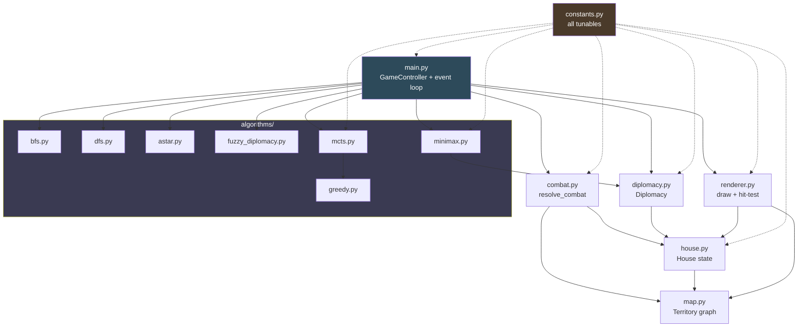

**Dependency rule:** `algorithms/` may import `map`, `house`, `diplomacy`, `constants` — but
nothing imports *from* `main.py` or `renderer.py`. The controller is the only place the layers
meet. `greedy.py` is the one intra-algorithm import (`mcts.py:19`).

---

## 1. `constants.py`

**Role:** single source of every tunable. No functions, no classes — pure module-level data.

**Imported by:** every other module.

| Group | Names | Lines |
|---|---|---|
| Window / grid | `WIDTH`, `HEIGHT`, `FPS`, `MAP_RECT_BOUNDS`, `GRID_COLS`, `GRID_ROWS`, `HEX_R`, `HEX_H`, `X_STEP`, `Y_STEP` | 8–19 |
| Palette | `INK`, `IVORY`, `MUTED`, `GOLD`, `STARK`, `LANNISTER`, `TARGARYEN`, `SEA` | 22–30 |
| House registry | `HOUSE_NAMES`, `HOUSE_COLORS`, `HOUSE_MOTTOS` | 32–42, 67–71 |
| AI / economy | `MINIMAX_DEPTH`, `MCTS_ITER`, `MCTS_ROLLOUT_DEPTH`, `UCT_C`, `BASE_INCOME`, `ARMY_COST`, `MIN_ATTACK_ARMIES`, `MAX_RECRUITS_PER_TURN`, `BETRAYAL_PENALTY`, `ALLY_BONUS` | 45–54 |
| Starting state | `STARTING_VALUES`, `STARTING_TERRITORIES` | 57–66 |
| Throne | `IRON_THRONE`, `THRONE_BONUS` | 74–75 |
| MCTS rewards | `REWARD_THRONE`, `REWARD_TERRITORY`, `REWARD_MILITARY`, `REWARD_RESOURCE`, `REWARD_ALLIANCE_RISK` | 81–85 |

`HEX_R` is **computed** from `MAP_RECT_BOUNDS` and the grid size (lines 13–16), so the board
rescales if the window dimensions change.

Full value table with usage sites: [`instruction 2.md` §0](instruction%202.md#0-master-constant-table--where-every-number-lives).

---

## 2. `map.py`

**Role:** the territory graph and all hex-grid geometry.

**Imports:** `constants`. **Imported by:** `house`, `combat`, `diplomacy`, all algorithms, `main`,
`renderer`.

### Module data

| Name | Line | Contents |
|---|---|---|
| `LANDMARKS` | 40–59 | `(col,row) → (name, feature, resource, owner)` — render lookup |
| `TERRITORY_SPECS` | 62–80 | the 19 territories, 9 fields each — **the authoritative source** |
| `TERRITORY_EDGES` | 82–… | hand-written adjacency — **overwritten at runtime, see below** |

### `class Territory` — line 10

Plain data holder. `__init__` (13–33) stores `name`, `col`, `row`, `feature`, `resource_value`,
`defense_bonus`, `armies`, `owner`, `is_iron_throne`, and an empty `neighbors` list filled later by
`Map.__init__`. `__repr__` (36–37) returns `Territory('NAME', owner=…, armies=…)`.

- `armies` = the **neutral garrison**; house seats are `0` because the house's pool defends them.
- `owner` is a **string or `None`**, never a `House` object — that is why callers go through
  `self.by_name[...]` to get the object.

### Module functions

| Function | Line | Parameters | Returns | How it works |
|---|---|---|---|---|
| `on_land` | 163 | `col, row: int` | `bool` | Hard-coded coastline test — which hexes are land vs sea |
| `_cube` | 177 | `col, row: int` | `(x, y, z)` | Offset → cube hex coordinates |
| `hex_distance` | 184 | `a, b: (col,row)` | `int` | Cube distance: `max(|dx|,|dy|,|dz|)` |
| `owner_at` | 190 | `col, row, game_map=None` | `str \| None` | Owner of the territory whose region contains this hex |
| `terrain_at` | 208 | `col, row: int` | `str` | Terrain kind for rendering (`snow`, `grass`, …) |

### `class Map` — line 223

`__init__` (226–286) runs a **four-stage build**:

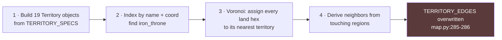

1. **Construct** each `Territory` from `TERRITORY_SPECS` (234–245).
2. **Index** into `by_name` and `by_coord`; locate `iron_throne` (246–247).
3. **Voronoi partition** (250–263): each land hex is assigned to the nearest territory by
   `hex_distance`, tie-broken by Euclidean distance. Stored in `_regions`.
4. **Derive adjacency** (266–286): two territories are neighbours iff their regions touch
   anywhere on the hex grid. Column parity selects the correct 6-neighbour offsets (272–276).

> ⚠️ **`TERRITORY_EDGES` is overwritten** at `map.py:285-286`:
> ```python
> if touching_pairs:
>     TERRITORY_EDGES[:] = sorted(touching_pairs)
> ```
> The hand-written edge list (`map.py:82+`) is **documentation only** — real adjacency comes from
> the Voronoi geometry. Editing that list changes nothing. This matters when reasoning about who
> borders King's Landing.

| Method | Line | Parameters | Returns | Notes |
|---|---|---|---|---|
| `region_of` | 288 | `col, row` | `Territory \| None` | Hex → owning territory; used for hover/click |
| `get_neighbors` | 291 | `Territory \| str` | `list[Territory]` | Accepts a name or an object |
| `get_owned_by` | 295 | `House \| str` | `list[Territory]` | Case-insensitive name match |
| `get_neutral` | 300 | — | `list[Territory]` | `owner is None` |
| `capture` | 303 | `territory, house \| None` | `None` | Sets `owner`; `None` reverts to neutral |
| `get_all` | 311 | — | `list[Territory]` | All 19 |

**Flow:** built once in `GameController.reset` (`main.py:49`); read by every algorithm and by the
renderer each frame.

---

## 3. `house.py`

**Role:** per-house mutable state, economy, and the diplomatic inbox.

**Imports:** `constants`, `map`. **Imported by:** `combat`, `diplomacy`, algorithms, `main`,
`renderer`.

### `class House` — line 16

`__init__` (19–46) parameters: `name`, `color=None`, `gold=40`, `armies=15`, `motto=""`,
`status="ACTIVE"`, `mode="DECOMPOSED"`, `fuzzy_scores=None`.

State fields: `name` (upper-cased, 30), `color`, `gold`, `armies`, `territories: list[Territory]`,
`allied_with: str | None`, `trust_history: dict`, `inbox: list` (37), `motto`, `status`,
`mode` (40 — `"DECOMPOSED"` / `"PARANOID"`), `is_human` (41), `fuzzy_scores` (42–46).

| Method | Line | Parameters | Returns | How it works |
|---|---|---|---|---|
| `collect_income` | 49 | — | `int` | `BASE_INCOME + Σ resource_value`; **adds to `self.gold`** and returns the amount |
| `recruit_armies` | 54 | `n: int` | `bool` | Deducts `n × ARMY_COST` if affordable, adds `n` armies; `False` if `n ≤ 0` or too poor. **No cap here** — the cap is the caller's (`main.py:241`) |
| `lose_territory` | 63 | `territory` | `None` | Removes from list; clears `territory.owner` if it was ours |
| `gain_territory` | 69 | `territory` | `None` | Sets `owner`, appends if absent |
| `is_eliminated` | 74 | — | `bool` | `len(self.territories) == 0` — **territories, not armies** |
| `get_military_strength` | 77 | — | `float` | `armies + Σ defense_bonus` — defence is **additive** here |
| `receive_proposal` | 81 | `proposal: dict` | `None` | Drops any prior proposal from the same sender (84), then appends — **one per sender** |
| `get_pending_proposal` | 87 | — | `dict \| None` | `inbox[0]`, i.e. oldest first |
| `clear_inbox` | 90 | — | `None` | Empties the list |

### `create_initial_houses(game_map)` — line 94

**Parameters:** `game_map: Map` · **Returns:** `list[House]` (3 houses in `HOUSE_NAMES` order).

Builds each house from `STARTING_VALUES` and `STARTING_TERRITORIES`, assigns its seat via
`gain_territory`, and seeds `trust_history` at 50 toward the others.

**Called from:** `GameController.reset` (`main.py:50`).

### Flow

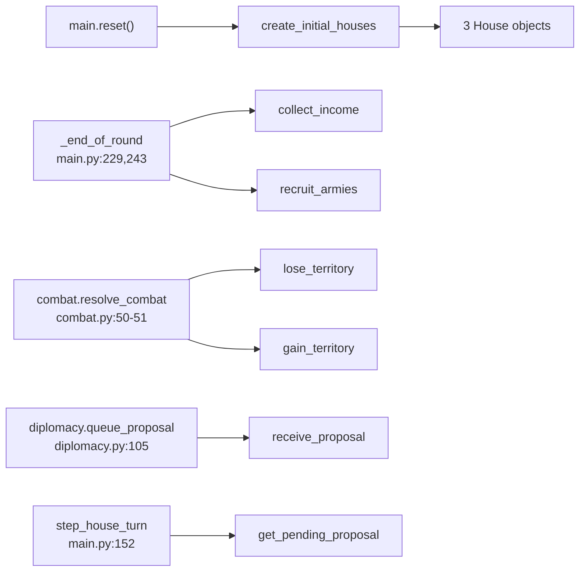

---

## 4. `combat.py`

**Role:** the single place a battle is decided. 67 lines, one static method.

**Imports:** `house`, `map`. **Imported by:** `main` only.

### `Combat.resolve_combat(attacker, defender, territory, game_map)` — lines 14–66

| Parameter | Type | Meaning |
|---|---|---|
| `attacker` | `House` | the attacking house — **its whole army pool fights** |
| `defender` | `House \| None` | **`None` means a neutral territory** defended by its own garrison |
| `territory` | `Territory` | the contested hex; supplies `defense_bonus` and, if neutral, `armies` |
| `game_map` | `Map` | for `capture()` |

**Returns** `dict` (60–66): `winner`, `loser`, `territory`, `attacker_losses`, `defender_losses`,
`territory_transferred`.

**Raises** `ValueError` if a house attacks itself (25–26).

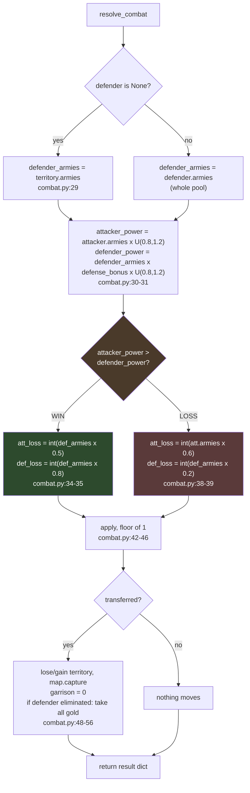

**Three facts that surprise readers:**

1. On a **win**, *both* casualty figures derive from `defender_armies` — the attacker's losses
   scale with the **defender's** size, not its own.
2. `int()` truncates, so losses round **down**.
3. `max(1, …)` floors every army count at 1 (42–46) — **combat can never eliminate a house.**
   Elimination is losing all territories (`house.py:74`).

**Flow in:** only `GameController._execute_attack` (`main.py:127`).
**Flow out:** mutates `House.armies/gold/territories` and `Territory.owner/armies`; the returned
dict drives the Raven's Log entry (`main.py:128-130`) and the march animation (`main.py:132-143`).

---

## 5. `diplomacy.py`

**Role:** alliances, bilateral trust, the asynchronous proposal queue, and the event log.

**Imports:** `constants`, `house` (type-only). **Imported by:** `minimax`, `mcts`, `main`.

### `_house_key(h)` — line 13

`House | str → str` (upper-cased). Every public method funnels through it, so all APIs accept
either a `House` object or a name string.

### `class Diplomacy` — line 17

`__init__(houses=None)` (20–32): `houses` dict, `alliances` (all `None`), `trust_scores` —
**every ordered pair initialised to 50.0** (25–29) — `pending_proposals` keyed by **target**
(30–31), `event_log` (32).

| Method | Line | Parameters | Returns | How it works |
|---|---|---|---|---|
| `_sync_house` | 33 | `name: str` | `None` | Pushes `allied_with` + `trust_history` onto the `House` object so the HUD can read them |
| `are_allied` | 43 | `h1, h2` | `bool` | True only if **both** directions point at each other |
| `form_alliance` | 47 | `h1, h2` | `None` | Clears any prior pacts (51–55), links both ways (56–57), sets **`mode = "PARANOID"`** on both (59–61) |
| `dissolve_alliance` | 62 | `h1, h2` | `None` | Unlinks, **no trust penalty**, sets `mode = "DECOMPOSED"` (73–74) |
| `break_alliance` | 74 | `h1, h2` | `None` | `dissolve_alliance` + `update_trust(…, "betray")` — the −30 path |
| `update_trust` | 80 | `actor, other, action: "betray"\|"keep"` | `float` | Applies −30 / +5, clamps to `[0,100]`, **writes both directions** (91–92) |
| `get_trust` | 94 | `h1, h2` | `float` | Defaults to 50.0 |
| `queue_proposal` | 99 | `proposer, target, turn` | `None` | Builds `{from, type, turn}`, stores under the target, calls `receive_proposal`, logs |
| `get_proposal` | 107 | `target_house` | `dict \| None` | Lookup by target |
| `resolve_proposal` | 110 | `proposer, target, accepted: bool, turn=0` | `None` | Pops the proposal, clears the inbox; accept → `form_alliance` + log, else log rejection |
| `_push` | 128 | `entry: dict` | `None` | Appends to `event_log`, trims to the **last 24** (130–131) |
| `log_event` | 133 | `turn, house, algo, decision` | `None` | `[Turn N] [House] used [Algo]: [Decision]` |
| `log_diplomacy` | 137 | `turn, house, text` | `None` | Free-text diplomacy line |

### Alliance state machine

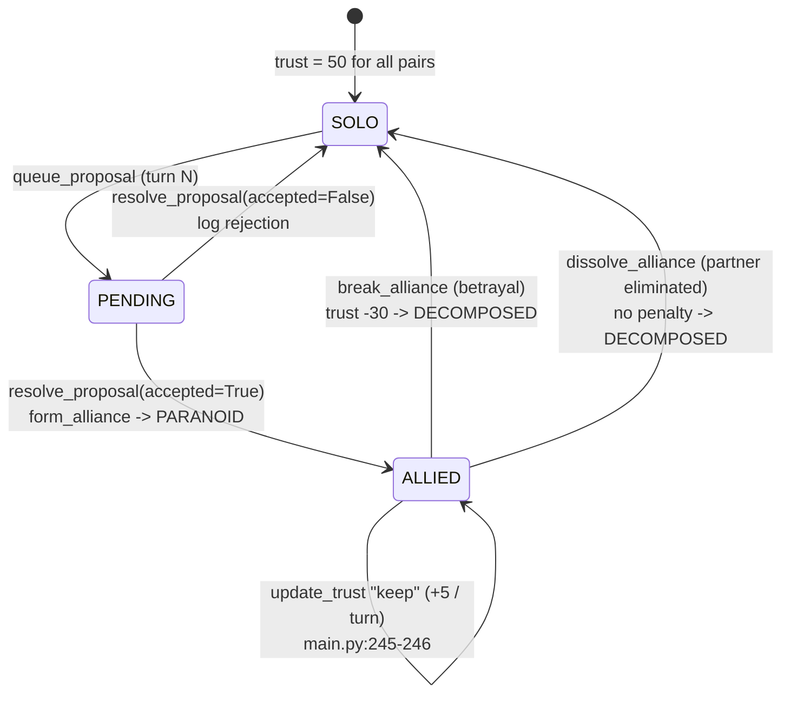

**Three lifecycle methods, not two.** `dissolve_alliance` is not in the spec; it exists so an
eliminated partner does not inflict a betrayal penalty (`main.py:145-146`). `break_alliance` is
built on top of it, which is why "switch to Decomposed" lives in `dissolve_alliance` (73–74).

**Trust is symmetric** (91–92) despite the pair-keyed store — a betrayer's own trust toward the
victim also drops 30.

---

## 6. `algorithms/`

### 6.1 `algorithms/bfs.py`

**`get_reachable(game_map, start, n_steps)` — line 10**

| | |
|---|---|
| **Parameters** | `game_map: Map`, `start: Territory`, `n_steps: int` |
| **Returns** | `set[Territory]` — everything within `n_steps` hops, **including `start`** |
| **How** | Classic BFS. `visited` seeded with `start` (12); `deque` of `(territory, distance)` (13). Pops, and **if `dist >= n_steps` skips expansion** (17–18). Neighbours marked visited **on enqueue** (20–22), so each is added once. |
| **Flow in** | `main.py:186` with `n_steps=3` |
| **Flow out** | assigned to `_reachable` — **currently unused**; the pipeline step runs for spec compliance |

`n` is a **radius**, not a count: the ball of radius `n`, not the shell at exactly `n`.

### 6.2 `algorithms/dfs.py`

**`get_expansion_paths(game_map, start, depth_limit)` — line 8**

| | |
|---|---|
| **Parameters** | `game_map: Map`, `start: Territory`, `depth_limit: int` |
| **Returns** | `list[list[Territory]]` — each inner list a path from `start` |
| **How** | Recursive inner `_dfs(current, path, depth)` (16–25). Records a path when `depth > 0` **and** the endpoint is neutral or `defense_bonus < 2` (17). Recurses while `depth < depth_limit` (19). Cycles blocked by `if neighbor not in path` (22); backtracks with `path.pop()` (25). |
| **Flow in** | `main.py:187` with `depth_limit=3` |
| **Flow out** | `_expansion` — **currently unused** |

`defense_bonus < 2` matches **only Harrenhal** (bonus 1) among non-neutral options.

### 6.3 `algorithms/astar.py`

| Function | Line | Parameters | Returns | How |
|---|---|---|---|---|
| `_heuristic` | 11 | `a, b: Territory` | `float` | `math.hypot(Δcol, Δrow)` — Euclidean on grid coords |
| `get_path` | 15 | `game_map, start, goal` | `list[Territory]` | A\* with `heapq`; **edge cost = `neighbor.defense_bonus`** (36), so it finds the **lowest-risk**, not shortest, route. `counter` breaks heap ties for stability (21–22). Returns `[start]` if `start == goal` (17–18), `[]` if unreachable. |

**Flow in:** `main.py:104`, when an attack target is not adjacent.
**Flow out:** `_execute_attack` takes `best_route[1]` — **only the first hop** is attacked
(`main.py:113`).

### 6.4 `algorithms/greedy.py`

| Function | Line | Parameters | Returns | How |
|---|---|---|---|---|
| `greedy_pick` | 16 | `candidates: Iterable[Territory]` | `Territory \| None` | `max` on key `(resource_value - defense_bonus, is_iron_throne)` (21). `None` on empty (19–20). **Takes a bare iterable** — that is what makes it reusable by MCTS. |
| `get_greedy_move` | 24 | `house: House`, `game_map: Map`, `enemies: list[House] \| None = None` | `Territory \| None` | Walks owned territories (34) → neighbours (35) → skips own (36–37) → keeps neutrals and listed enemies (38–39) → into a `set` (dedupe) → `greedy_pick`. `enemies=None` disables the filter (31). |

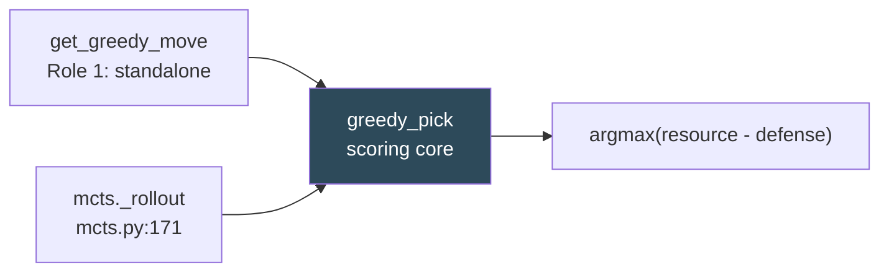

**The split is the whole point:** `get_greedy_move` is map-aware (Role 1); `greedy_pick` is the
pure scorer imported by `mcts.py:19` as the rollout opponent model (Role 2).

### 6.5 `algorithms/fuzzy_diplomacy.py`

| Function | Line | Parameters | Returns | How |
|---|---|---|---|---|
| `_trimf` | 31 | `x: ndarray`, `abc: (a,b,c)` | `ndarray` | Hand-written triangular membership matching `skfuzzy.trimf`; handles the degenerate `a==b` / `b==c` shoulders (39–42) |
| `_interp_membership` | 49 | `universe, mf, value` | `float` | `np.interp` after clipping to `[0,100]` |
| `_defuzz_centroid` | 53 | `universe, aggregated` | `float` | `Σ(x·y)/Σy`; **returns `0.0` if total area ≤ 1e-9** — "no rule fired → no desirability" (55–56) |
| `_evaluate_skfuzzy` | 60 | `e_val, w_val, t_val` | `dict` | Builds 3 Antecedents + 3 Consequents on universe `0..100`, assigns the same low/medium/high triangles to all six (69–72), declares the 6 rules (75–82), runs `ControlSystemSimulation` |
| **`evaluate_diplomacy`** | **95** | `enemy_strength, own_weakness, trust_history` (all 0–100) | `dict{"alliance","betrayal","solo"}` each `0.0–1.0` | Clips inputs (103–105); tries `skfuzzy` (107–110) and falls back to the pure-NumPy Mamdani path (112–153) on `ImportError` **or any exception** — `skfuzzy` raises when a consequent gets no activation |

**NumPy fallback pipeline** (112–153): fuzzify (118–128) → rule strengths via `min` (131–136) →
clip-and-aggregate via `np.minimum`/`np.maximum` (138–150) → centroid, `/100`, `round(…,2)`
(151–153).

**Flow in:** `main.py:80` (Context A) and `main.py:88` (Context B).
**Flow out:** stored on `house.fuzzy_scores` (HUD, `renderer.py:2147`) and passed to MCTS as UCT
biases.

### 6.6 `algorithms/minimax.py`

#### Internal state

**`class _State` — line 22.** `__slots__` snapshot of `owner`, `garrison`, `armies`, `gold`.
`copy()` (39–41) returns a shallow-copied clone so the search never touches real objects.

| Function | Line | Parameters | Returns | How |
|---|---|---|---|---|
| `_snapshot` | 43 | `all_houses, game_map` | `_State` | Reads live objects into a search snapshot |
| `_evaluate_state` | 52 | `me, enemy_names, game_map, state` | `float` | `own_territory·2 + armies·1.5 + gold·0.5 + throne(500) − enemy_score` |
| `evaluate` | 71 | `house, enemies, game_map, state=None` | `float` | Public wrapper matching the spec's signature; snapshots if `state` is `None` |
| `_moves` | 78 | `state, game_map, name, forbidden` | `list[Territory]` | Adjacent non-owned, minus `forbidden` (allies). **Two guards:** below `MIN_ATTACK_ARMIES=5` only neutrals (92–93); the throne is excluded unless `armies ≥ garrison × defense_bonus` (96–99) |
| `_apply` | 105 | `state, attacker, target` | `_State` | **Deterministic** combat — the same casualty model with randomness fixed at 1.0 |
| `_alphabeta` | 130 | `state, game_map, me, my_forbidden, opponents, eval_enemies, depth, alpha, beta, maximizing` | `float` | Standard α-β. MIN node pools **all** opponents' replies into one list (161–164) — that is what makes Paranoid a coalition. Cuts on `alpha >= beta` |
| `_search_root` | 177 | `…, root_moves, depth` | `dict[str\|None, float]` | Scores each root move; keys are territory **names**, `None` = hold |
| `decomposed_minimax` | 200 | `house, enemies, game_map, root_moves, state, my_forbidden, depth=3` | `Territory \| None` | One search **per enemy**, blended by strength share (210–220) |
| `paranoid_minimax` | 225 | same | `Territory \| None` | **One** search with all enemies as a merged coalition (238) |
| `_pick` | 242 | `scores, game_map` | `Territory \| None` | argmax, tie-breaking toward a real move over `None` |
| **`get_best_move`** | **249** | `house, all_houses, game_map, diplomacy, betray_target=None` | `Territory \| None` | Entry point — builds state, picks mode, dispatches |

#### Mode selection

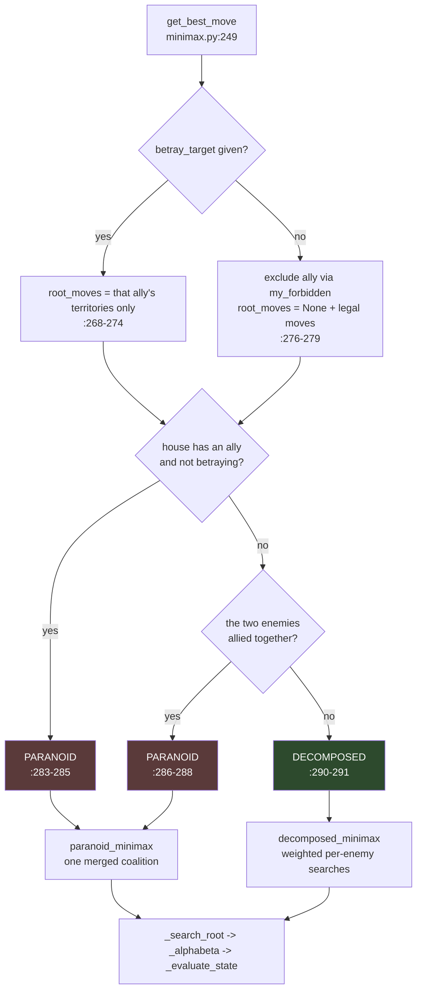

`house.mode` is written on every call (284, 287, 290) and rendered at `renderer.py:1935`.

**Flow in:** `main.py:175` (proposal branch), `main.py:215` (normal branch), `main.py:392`
(human betrayal strike).
**Flow out:** the chosen `Territory` goes to `_execute_attack`.

### 6.7 `algorithms/mcts.py`

#### Internal classes

**`class _MCTSNode` — line 44.** One per root action: `action`, `bias` (the fuzzy score),
`visits`, `total_reward`. **The tree is one level deep** — this is flat MCTS / multi-armed bandit,
not a growing tree.

**`class _Sim` — line 52.** Index-based rollout state for speed.

| Method | Line | Parameters | Returns | How |
|---|---|---|---|---|
| `__init__` | 55 | `all_houses, game_map` | — | Converts the graph to integer `adjacency` lists (59); caches `throne` index, `owner`, `garrison`, `armies`, `gold` |
| `clone` | 66 | — | `_Sim` | `object.__new__` + copies only the mutable parts — shares the immutable graph |
| `alive` | 78 | `name` | `bool` | `name in self.owner` |
| `candidates` | 81 | `name, protected, only=None` | `list[Territory]` | Frontier; `protected` shields an ally, `only` restricts to one victim (betrayal) |
| `attack` | 95 | `attacker, target` | `None` | Mirrors `combat.py` exactly — same `0.8–1.2` rolls and `0.5/0.8/0.6/0.2` casualties |
| `economy` | 118 | — | `None` | `BASE_INCOME + Σ resource`, then recruits `(gold // ARMY_COST) // 2` — **differs from the real `min(3, (gold−15)//5)`** |
| `reward` | 129 | `me, alliance_risk_penalty` | `float` | The weighted sum from `constants.py:82-85` |

#### Functions

| Function | Line | Parameters | Returns | How |
|---|---|---|---|---|
| `_rollout` | 142 | `base, me, partner, trust, alliance_active, alliance_pending, betray_first` | `float` | Clones the sim, plays `MCTS_ROLLOUT_DEPTH=10` turns. Each step: alliance break check `random() < 1 − trust/100` (162); then **every** house attacks via `greedy_pick` (171). Terminal checks at 181–191. Returns reward ÷ `REWARD_SCALE`. |
| `_run_uct` | 199 | `actions: dict[str,float]`, `simulate: dict[str,callable]` | `str` | Builds one node per action; expands unvisited first (203–205); else argmax `Q/N + 1.414·√(ln N_p/N) + bias` (206–212); 500 iterations; **returns the most-visited child** (214) |
| **`get_diplomacy_decision`** | **222** | `house, all_houses, game_map, fuzzy_scores, diplomacy` | `(action, House \| None)` | Context A. Has ally → `{solo, betray}`; no ally → `{solo, propose_alliance}` with the **most-trusted, weakest-on-tie** partner (237); <2 others → `("solo", None)` |
| **`get_proposal_response`** | **262** | `house, proposer, all_houses, game_map, fuzzy_scores, diplomacy` | `"accept" \| "reject"` | Context B. Auto-rejects if either side is eliminated (265–266) or ≤2 houses survive (267–269). Biases: `accept ← alliance`, `reject ← max(betrayal, solo)` |

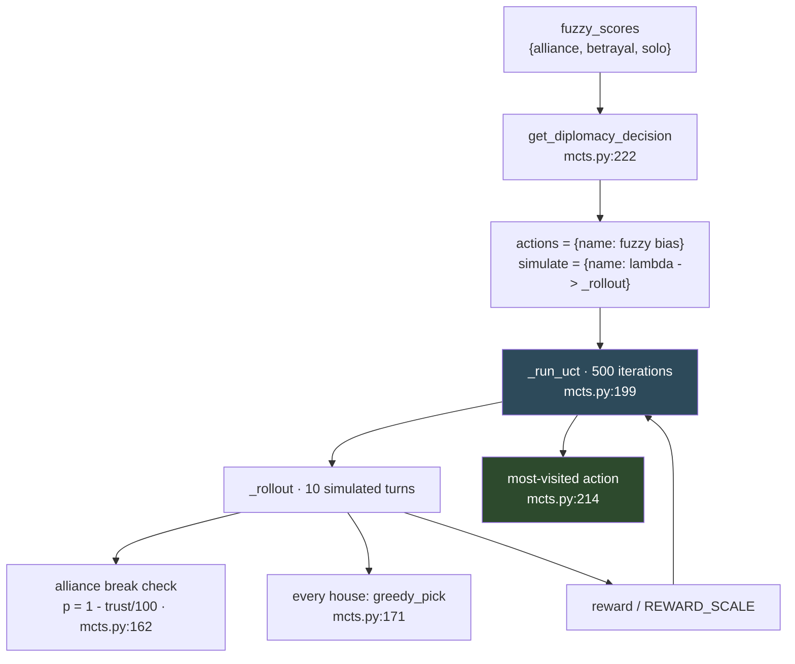

**Fuzzy enters as an additive UCT bias only** — it never selects an action outright.

---

## 7. `main.py`

**Role:** `GameController` (all game state and the turn pipeline) plus the pygame event loop.

**Imports:** everything. **Imported by:** nothing — it is the entry point.

### Module-level

| Function | Line | Parameters | Returns | How |
|---|---|---|---|---|
| `_scale_military` | 35 | `strength: float` | `float` | `clamp(strength × 2.5, 0, 100)` — maps raw strength onto the fuzzy 0–100 universe. **Saturates at strength 40.** |
| `_enable_windows_dpi_awareness` | 415 | — | `None` | `ctypes` call so the window is not blurred on scaled displays |
| `main` | 428 | — | `None` | Builds the window, runs the pygame loop: events → `update_animations` → `draw_screen` at `FPS` |

### `class GameController` — line 39

| Method | Line | Parameters | Returns | How it works | Called from |
|---|---|---|---|---|---|
| `__init__` | 42 | `mode="AI vs AI"`, `human_house="STARK"` | — | Delegates to `reset` | `main()` |
| `reset` | 47 | `mode=None`, `human_house=None` | `None` | Rebuilds `Map`, houses, `Diplomacy`; sets `turn=1`, `winner=None`, clears animations; marks the human house | `__init__`, menu |
| `_update_context_a_fuzzy` | 71 | `house` | `dict` | `enemy_strength` = scaled **sum** of all enemies (73); `own_weakness` = `100 − scaled(own)` (74); `trust` = **mean** toward enemies (75–79). Writes `house.fuzzy_scores` | `:190`, `:247`, `:303`, `:341` |
| `_update_context_b_fuzzy` | 84 | `house, proposer` | `dict` | Same, but strength/trust refer to **the proposer only** (85–87) | `:162` |
| `_execute_attack` | 92 | `house, target_territory` | `None` | Adjacency → else A\* → first border hop; auto-betrayal if the target is an ally (120–123); `Combat.resolve_combat` (127); logs; queues the march animation; dissolves orphaned alliances (145–146) | `:177`, `:219`, `:368`, `:393` |
| `step_house_turn` | 148 | `house` | `None` | **The spec pipeline.** Branch A (proposal present) 155–180; Branch B 181–223 | `advance_turn`, `_pump_animated_turn` |
| `_end_of_round` | 224 | — | `None` | Steps 8–11: income (229), recruit capped at 3 (240–243), `"keep"` trust (245–246), `check_winner` + `turn += 1` (250–252) | `advance_turn`, `_pump_animated_turn` |
| `advance_turn` | 254 | — | `None` | Synchronous full round — every house, then `_end_of_round`; early-returns on a winner | headless / tests |
| `has_blocking_animation` | 266 | — | `bool` | Any `"march"` animation in flight |
| `is_turn_busy` | 270 | — | `bool` | `_round_in_progress or has_blocking_animation()` |
| `start_animated_turn` | 274 | — | `None` | Begins an animated round at house 0 | UI button |
| `_pump_animated_turn` | 282 | — | `None` | **The animation-aware driver.** Loops while not blocked; stops at a human house (302–307); calls `_end_of_round` at wrap (291–297); returns when a march starts (309–310) | `start_animated_turn`, `update_animations`, `handle_human_action` |
| `update_animations` | 311 | `dt: float` | `None` | Advances `elapsed`, drops finished ones; when the last march ends, resumes `_pump_animated_turn` (320–323) | event loop, every frame |
| `active_house` | 324 | — | `House` | `self.houses[self.active_index]` |
| `advance_until_human_or_end` | 327 | — | `None` | Runs AI houses until the human's turn or a winner |
| `handle_human_action` | 348 | `action: str`, `target_territory=None` | `bool` | `accept`/`reject` resolve the inbox and **do not consume the turn** (354–362). Otherwise `attack` / `ally_<HOUSE>` / `betray` / `hold` (364–391), then `check_winner` and hand off to the AI | `renderer.handle_click` → event loop |
| `check_winner` | 403 | — | `House \| None` | **Any owner of the Iron Throne wins** (405–406) | `:250`, `:395` |

### The two turn drivers

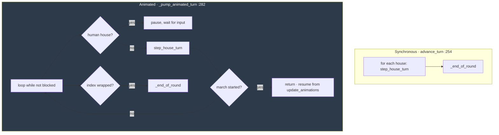

`advance_turn` is the clean synchronous path (useful for tests); `_pump_animated_turn` is what the
game actually runs, yielding whenever a battle animation needs to play.

### Per-house turn pipeline

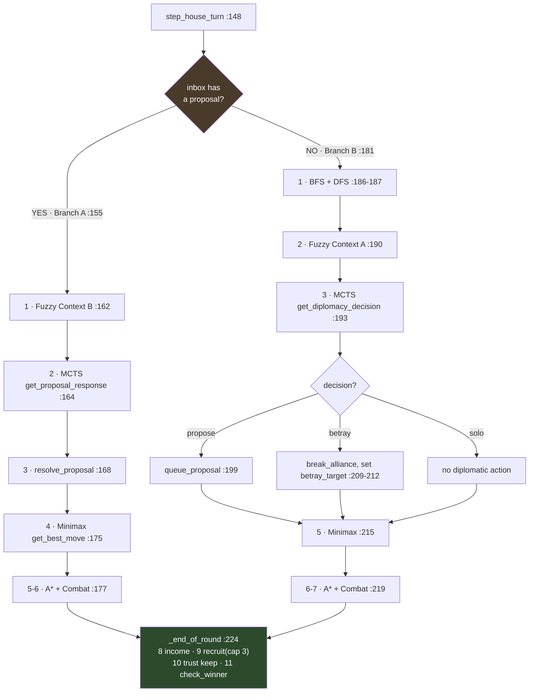

---

## 8. `renderer.py`

**Role:** every pixel, plus mouse hit-testing. 2651 lines, ~70 functions, **no game logic** — it
reads state and returns click intents.

**Imports:** `constants`, `map`, `house`, `pygame`. **Imported by:** `main`.

### Entry points (the only two `main.py` calls)

| Function | Line | Parameters | Returns | Role |
|---|---|---|---|---|
| `draw_screen` | 2645 | `surface, controller, …` | `None` | Top-level frame draw — called every tick from the event loop |
| `handle_click` | 2199 | `pos, controller, …` | action / `None` | Converts a click into an intent, which `main.py` passes to `handle_human_action` |

### Functions by group

| Group | Functions | Lines |
|---|---|---|
| **Fonts & text** | `make_font`, `make_fonts`, `_get_fonts`, `write`, `write_right` | 62–144 |
| **Geometry** | `hex_points`, `center_of`, `hex_at`, `_hex_mask`, `_soften`, `_land_cells`, `_region_info` | 153–173, 1466–1503, 2186 |
| **Terrain & layers** | `_build_sea_base`, `draw_sea_animated`, `_tile_seamless`, `_terrain_texture`, `build_land_layer`, `get_land_layer`, `_draw_border_line`, `draw_roads_and_rivers` | 221–362, 1334–1612 |
| **Sprites & decor** | `get_sprite`, `_load_tree_sprite`, `_deco_sprite`, `_decorations_for`, `draw_isometric_tile`, `draw_isometric_landmark`, `_draw_fallback_castle`, `draw_castle_banner`, `draw_wall_ring`, `_draw_plaque` | 93–115, 301–543, 1614–1762 |
| **Ambient animation** | `draw_smoke_wisps`, `draw_knight_squad`, `_dragon_direction`, `_get_dragon_frames`, `_draw_patrol_dragon`, `_draw_sailing_ships`, `_get_warrior_frames`, `_draw_road_patrols`, `_draw_drifting_clouds`, `_draw_ambient_weather` | 393–856 |
| **Battle animation** | `_draw_warrior_unit`, `_draw_animations` | 857–1102 |
| **HUD / panels** | `draw_crest`, `draw_glass_panel`, `draw_backdrop`, `draw_top_bar`, `draw_house_stat_card`, `draw_diplomacy_panel`, `draw_raven_panel`, `draw_hud_toggles`, `draw_sidebar`, `draw_vignette` | 1103–1333, 1764–2185 |
| **Interaction** | `hex_at`, `handle_click`, `draw_hover`, `_draw_button` | 2186–2328 |
| **Screens** | `draw_startup_menu`, `draw_human_prompt`, `draw_ai_prompt`, `draw_game_over_banner`, `draw_win_screen`, `draw_world`, `draw`, `draw_screen` | 1775–1905, 2329–2651 |

### HUD elements required by the spec

| Spec requirement | Implementation | Line |
|---|---|---|
| Inbox indicator | `"PROPOSAL PENDING IN INBOX"` | 1949 |
| Active Minimax mode | `("MINIMAX", house_data["mode"], …)` | 1935 |
| Fuzzy score bars | `draw_diplomacy_panel` — ALLIANCE / BETRAYAL / SOLO WAR | 1966–2001 |
| Turn log | `draw_raven_panel` | 2003–2059 |
| Human accept/reject | `(("accept","ACCEPT",…), ("reject","REJECT",…))` | 2410 |

> ⚠️ `renderer.py:2285` and `:2294` render `Fortifications: +{def_bonus} Defense`. The stat is
> **multiplicative** (`combat.py:31`), so this understates defence badly. See
> [`TO_IMPLEMENT.md` §C1](TO_IMPLEMENT.md).

### Render & input flow

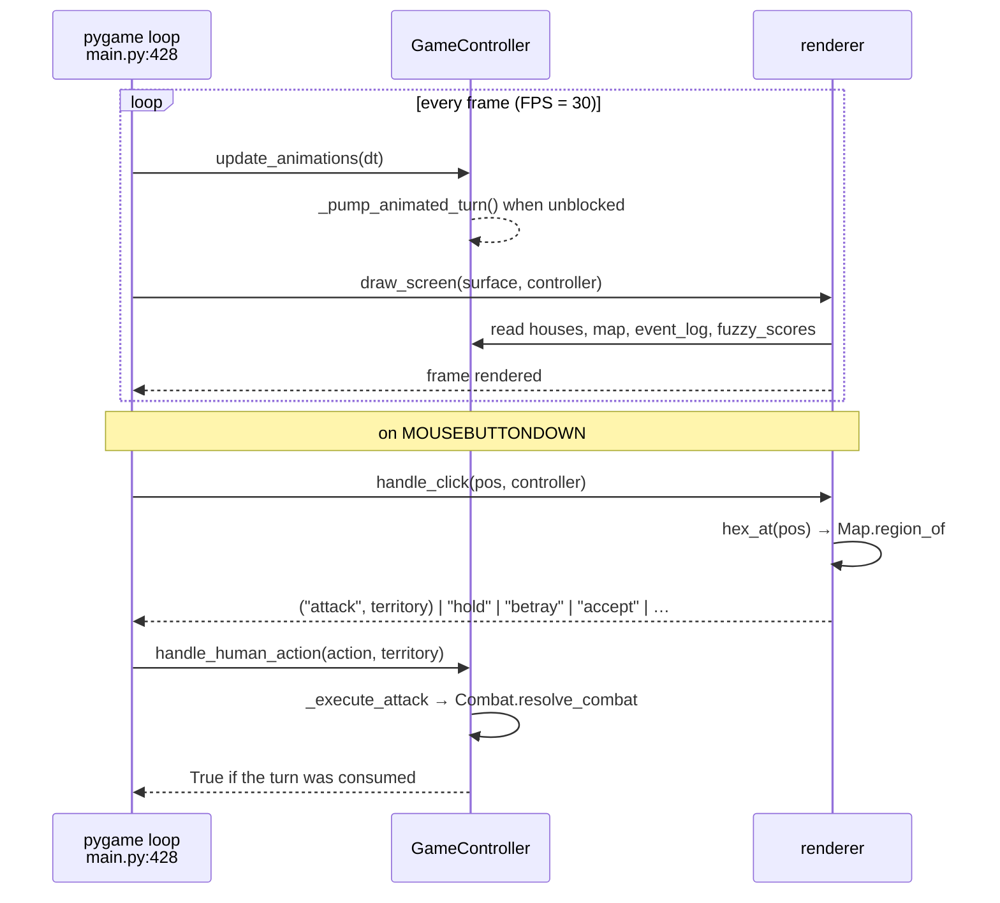

**The renderer never mutates game state.** It reads the controller and returns intents; all
mutation happens in `GameController`.

---

## Appendix — complete call graph of one AI turn

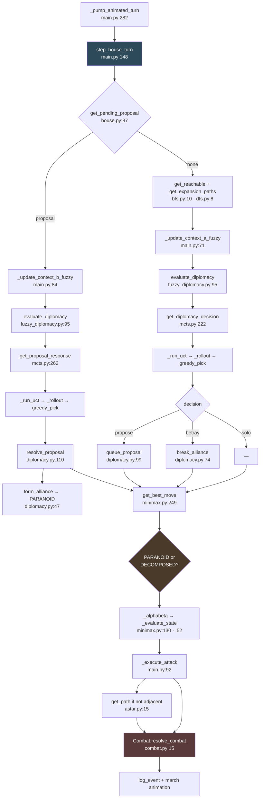
