# Game of Thrones: AI Conquest — Revised Deck (visual edition)

Slide-by-slide content for the 27-slide deck. Every fact, number, formula, situation and speaker note from the original is kept; text has been restructured into diagrams, tables and callouts.

- **Diagrams:** Mermaid. Renders on GitHub, in VS Code (Markdown Preview Mermaid Support) and at mermaid.live, which exports PNG/SVG for PowerPoint.
- **Callouts:** 💡 Key Insight · 🎓 Exam/Interview Tip · ⚠️ Common Mistake · ❓ Why this algorithm?
- **Screenshots** referenced as `screenshots/…` are in `presentation/screenshots/`; clips are in `presentation/clips/`.
- **Colour key used in every diagram:** gold = scouting/diplomacy, blue = alliance/answering offers, ember = war.


---

## Section 1 — The Game

---

### Slide 1 – Cover (Revised)

**Game of Thrones: AI Conquest**
*Three Great Houses. One Iron Throne. Seven AI algorithms.*

| | |
|---|---|
| Course | KUET · Artificial Intelligence Project |
| Type | Turn-based 2.5D strategy game |
| Team | [Team member names] |
| Background | `screenshots/03_start_map.jpg` (faded) on the sea + compass theme |

🗣️ **Speaker note:** Three houses compete for King’s Landing, and every decision an AI house makes comes from classic AI algorithms working together.

---

### Slide 2 – A Strategy Game Where AI Plays Every House (Revised)

| 🏰 **19** Holds | 👑 **3** Great Houses | ⚔️ **1** Move per turn | 🏆 **2** Ways to win |
|---|---|---|---|
| Castles on a 21 × 8 hex map. Two holds are neighbours when their coloured regions touch. | Stark, Lannister, Targaryen. Turn order shuffled every new game. | Attack one hold, betray and strike, or hold. | Hold King’s Landing at the end of a round, **or** be the last house with land. |

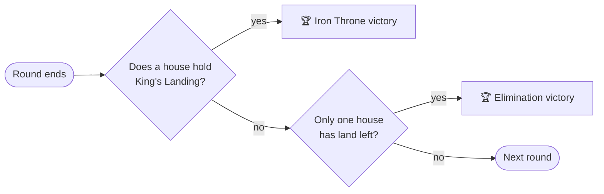

> 💡 **Key Insight** — The winner is checked only after the *whole* round, so rivals later in the round get one last chance to retake the throne.

> ⚠️ **Common Mistake** — Allies **never** share gold or armies. An alliance is only a non-aggression pact.

🗣️ **Speaker note:** Randomized turn order keeps the game fair: in 8 simulated games the wins split 3 / 3 / 2.

---

### Slide 3 – Two Modes: Watch the AI, or Fight It (Revised)

| | 👁️ **AI vs AI · Observer** | 🗡️ **Human vs AI · Command** |
|---|---|---|
| Screenshot | `screenshots/07_ai_brain_trace.jpg` | `screenshots/13_human_turn.jpg` |
| Who plays | All three houses are AI | You lead one house against two AIs |
| How you act | **ADVANCE TURN**, Space or Enter steps through | Click a hold to attack · **ALLY** offers · **BETRAY** · **HOLD TURN** |
| What you see | Open **AI BRAIN [H]** to watch each algorithm decide | Hovering a hold shows its **Minimax score** |

**Controls**

| Key | Action | Key | Action |
|---|---|---|---|
| P | Pause / resume | L | Raven Log |
| R | Restart | M | Music |
| H | AI Brain | F11 | Fullscreen |

> 💡 **Key Insight** — In Human mode, clicking a *distant* hold uses **A\*** to march one step along the safest route toward it.

---

### Slide 4 – Gameplay: The Realm in Motion (Revised)

| 🎬 AI vs AI · Targaryen takes The Eyrie | 🎬 Human vs AI · Stark storms the throne |
|---|---|
| `clips/ai_battle.webm` | `clips/human_kings_landing.webm` |
| **Turn 1:** Minimax picks a neutral hold next to Dragonstone; dragon and army march in. | **Turn 12:** the player attacks King’s Landing with **28 armies** after taking **11 holds**. |

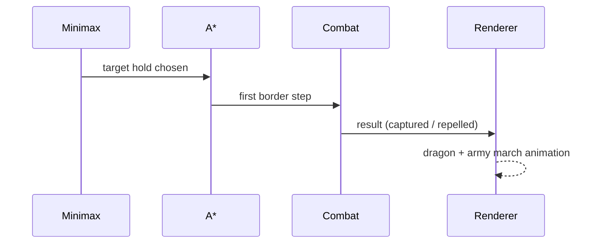

🗣️ **Speaker note:** Clips play automatically while presenting; click to pause. Recorded on a slightly earlier build where King’s Landing had 10 defenders instead of 11. *(Full-length videos at 1.25× are being added manually.)*

---

### Slide 5 – Starting Positions: Balanced Houses, One Fortified Throne (Revised)

| House | Capital | Gold | Armies | Income | Defense |
|---|---|---:|---:|---:|---:|
| 🐺 Stark | Winterfell | 60 | 14 | +9 | 3 |
| 🦁 Lannister | Casterly Rock | 65 | 14 | +9 | 2 |
| 🐉 Targaryen | Dragonstone | 60 | 14 | +8 | 4 |
| 👑 **Iron Throne (neutral)** | **King’s Landing** | — | **11** | **+15** | **3** |

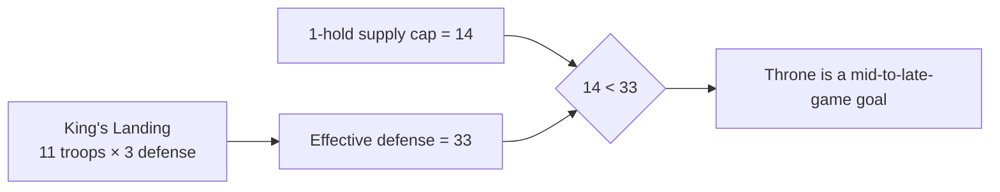

- The other **15 holds** are neutral with **2–4 troops** and **1–3 defense**.
- Every pair of houses starts at **trust 50**.

> 💡 **Key Insight** — 33 is above anything a 1-hold house can ever field (cap 14), so nobody can rush the throne.

---

### Slide 6 – The Sequence: One Round, House by House (Revised)

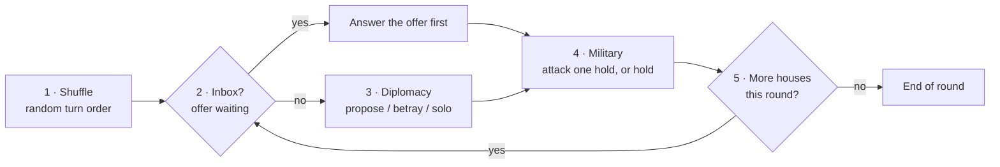

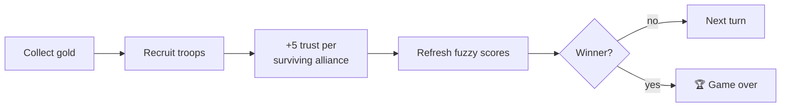

> 💡 **Key Insight** — Every house moves exactly once per round; the winner is checked only after all houses have acted.

🎬 **Build:** reveal steps 1 → 5, then the end-of-round strip.

---

## Section 2 — Where Each Algorithm Sits

---

### Slide 7 – Algorithms in the Flow: Seven Algorithms, One Job Each (Revised)

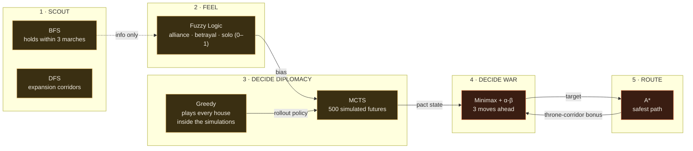

| Stage | Algorithm | Produces | Decides? |
|---|---|---|---|
| Scout | BFS + DFS | Reachable holds, corridors (shown as scouting info) | ❌ |
| Feel | Fuzzy Logic | 3 scores in 0–1 | ❌ scores only |
| Decide diplomacy | MCTS (+ Greedy inside) | propose / betray / solo / accept / reject | ✅ diplomacy |
| Decide war | Minimax | one hold to attack, or Hold | ✅ war |
| Route | A* | safest path to King’s Landing; first step to a distant click | ✅ route |

> 💡 **Key Insight — clean split:** Fuzzy only **scores**. MCTS only decides **diplomacy**. Minimax + A* only decide **war**. No algorithm both scores and decides.

---

### Slide 8 – AI Made Visible: The AI Brain Panel (Revised)

`screenshots/07_ai_brain_trace.jpg` — House Targaryen, turn 2, seeded AI vs AI game.

| Panel section | What it shows (real values) |
|---|---|
| 🟡 **Diplomacy** | Fuzzy bias → MCTS: **Solo 393 visits** vs **Propose 107** |
| 🟠 **Combat** | Minimax score for each hold, with the pick marked |
| 🔵 **Route** | A* corridor to the throne, plus the Greedy rollout pick |

> 🎓 **Exam/Interview Tip** — Explainability: showing *why* an AI chose a move (scores, visit counts) is as important as the move itself. Press **H** in the game to open this panel.

---

## Section 3 — Each Algorithm in Depth

Every algorithm slide uses the same 4-box card: **Takes → Calculates → Returns → Why**, followed by a real situation.

---

### Slide 9 – Algorithm 1 · Breadth-First Search: What Can We Reach in 3 Marches? (Revised)

| 📥 Takes | ⚙️ Calculates | 📤 Returns |
|---|---|---|
| The map, a start hold (the capital) and `n_steps = 3` | Visits holds **ring by ring** with a queue: 1 step away, then 2, then 3, never twice | The set of reachable holds → `house.reachable_holds` |

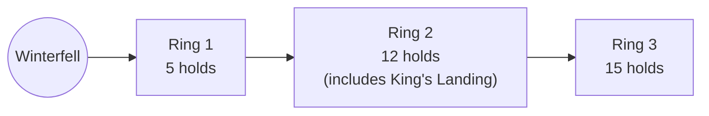

| Steps | Reachable from Winterfell (cumulative) |
|---:|---:|
| 1 | 5 |
| 2 | 12 ← King’s Landing enters |
| 3 | 15 |

> ❓ **Why BFS?** It finds everything within a fixed number of steps in the fewest operations, with no weights needed.

> 🎓 **Exam/Interview Tip** — BFS uses a **queue** (FIFO) and runs in O(V + E). On an unweighted graph it gives shortest step-counts.

> ⚠️ **Common Mistake** — BFS and DFS here are **scouting information**; they don’t change Minimax or MCTS scores.

---

### Slide 10 – Algorithm 2 · Depth-First Search: Which Expansion Corridors Exist? (Revised)

| 📥 Takes | ⚙️ Calculates | 📤 Returns |
|---|---|---|
| The map, the capital and `depth_limit = 3` | Follows one path as deep as allowed, then **backtracks**, never revisiting a hold on the same path | Every path that ends in a **neutral or weak** hold (defense < 2) → `house.expansion_paths` |

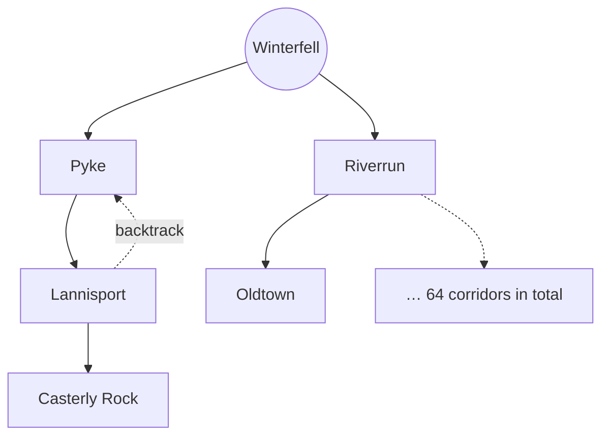

**Situation:** from Winterfell with depth 3, DFS finds **64 cycle-free expansion corridors**.

| | BFS | DFS |
|---|---|---|
| Answers | “How far?” | “Which routes?” |
| Data structure | Queue | Stack / recursion |
| Output | Set of holds | List of whole paths |

> ❓ **Why DFS?** It lists whole multi-step routes, not just distances, using very little memory.

> 🎓 **Exam/Interview Tip** — DFS memory is O(depth), versus BFS’s O(width of the frontier).

---

### Slide 11 – Algorithm 3 · Greedy Search: Take the Best-Looking Hold Right Now (Revised)

$$t^{*} = \arg\max_{t \in \text{candidates}} \big( r(t) - b(t) \big) \qquad r = \text{gold income},\; b = \text{defense bonus}$$

| 📥 Takes | 📤 Returns |
|---|---|
| All adjacent holds that aren’t mine or my ally’s | One target hold; **ties go to King’s Landing** |

**Situation · Stark, turn 1**

| Adjacent hold | r | b | r − b | |
|---|---:|---:|---:|---|
| **Riverrun** | 5 | 2 | **3** | ✅ Greedy pick |
| Pyke | 4 | 2 | 2 | |
| The Twins | 5 | 3 | 2 | ⭐ Minimax’s pick (Slide 16) |
| The Wall | 4 | 3 | 1 | |

> ❓ **Why Greedy?** Instant, so it can play every house inside 500 MCTS simulations.

> ⚠️ **Common Mistake** — Greedy is **not** the AI’s war decision. It has no look-ahead, so it is the fast opponent model inside MCTS rollouts. The real move comes from Minimax, which prefers The Twins.

---

### Slide 12 – Algorithm 4 · A* Pathfinding: The Safest Road to the Throne (Revised)

$$f(n) = g(n) + h(n) \qquad g = \textstyle\sum \text{defense bonuses crossed so far},\quad h = \text{hex distance left to the goal}$$

| 📥 Takes | ⚙️ Calculates | 📤 Returns |
|---|---|---|
| The map, a start hold and a goal hold | Expands the hold with the lowest f(n) first | Ordered list of holds with the lowest total defense found |

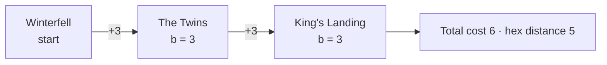

**Two uses**

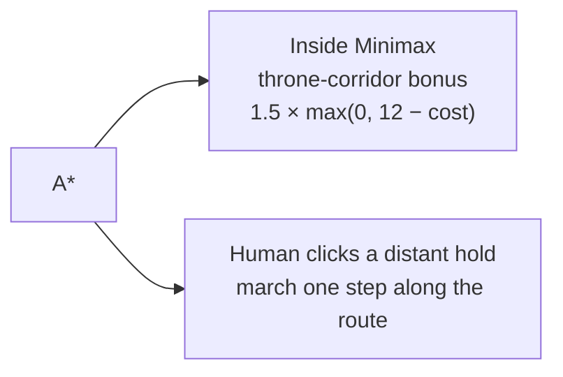

> ❓ **Why A\*?** A cost-so-far plus a distance estimate focuses the search toward the goal, so it explores far fewer holds than a blind search.

> 🎓 **Exam/Interview Tip** — A\* is guaranteed optimal only if h never overestimates the remaining cost (an *admissible* heuristic).

> ⚠️ **Common Mistake (found in this project)** — Here one move between neighbouring regions can span several hexes but cost as little as 1, so hex distance **can** overestimate (256 of 342 hold pairs). Every route **to King’s Landing** is still optimal (so Minimax is unaffected); 35 other pairs are 1–2 cost points off. Fix: scale h, e.g. h = hex distance ÷ (largest hex span of one move).

---

### Slide 13 – Algorithm 5 · Mamdani Fuzzy Logic: Feelings About Allies, as Numbers (Revised)

**Pipeline**

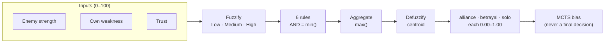

**How the inputs are built**

| Input | Formula |
|---|---|
| Strength | (armies + Σ defense) × 2.5, capped at 100 |
| Own weakness | 100 − own scaled strength |
| Trust | 0–100 (Context A: average toward rivals · Context B: toward the sender) |

**Membership sets (same for every input and output)**

```text
1.0 |Low\        /\Medium      /High
    |    \      /  \         /
    |     \    /    \      /
0.0 |______\__/______\___/________
    0      20  40 50  60 80     100
    Low = (0,0,60)  Medium = (20,50,80)  High = (40,100,100)
```

**The 6 rules**

| # | IF | THEN |
|---|---|---|
| 1 | Enemy **High** ∧ Weakness **High** | Alliance **High** |
| 2 | Trust **Low** ∧ Enemy **Medium** | Alliance **Low** |
| 3 | Weakness **Low** ∧ Enemy **Low** | Betrayal **High** |
| 4 | Weakness **Low** ∧ Trust **High** | Solo **High** |
| 5 | Enemy **High** ∧ Trust **High** | Alliance **Medium** |
| 6 | Trust **Low** | Betrayal **Medium** |

**Two contexts**

| | Context A — own diplomacy | Context B — incoming offer |
|---|---|---|
| Enemy | Both rivals combined | The **third** house |
| Trust | Average toward rivals | Toward the sender |

> ❓ **Why Fuzzy Logic?** No brittle cut-offs like “weak if armies < 10”. Inputs blend smoothly, the way humans reason.

> ⚠️ **Common Mistake** — Solo has only **one** rule (rule 4), so its output is either **0** or about **0.70–0.80**, never in between.

---

### Slide 14 – Fuzzy Logic · Situations: Same Rules, Different Moods (Revised)

| Situation | Enemy | Weak | Trust | Alliance | Betrayal | Solo | Mood |
|---|---:|---:|---:|---:|---:|---:|---|
| Weak house vs a giant | 100 | 80 | 50 | **0.73** 🟢 | 0.50 | 0.00 | 🤝 wants an ally |
| Weak, trusted partner | 100 | 80 | 80 | **0.65** 🟢 | 0.00 | 0.00 | 🤝 wants an ally |
| Dominant, low trust | 30 | 10 | 20 | 0.25 | **0.62** 🔴 | 0.00 | 🗡️ leans to betrayal |
| Balanced, high trust | 60 | 40 | 90 | 0.50 | 0.00 | **0.75** 🔵 | 🛡️ goes solo |

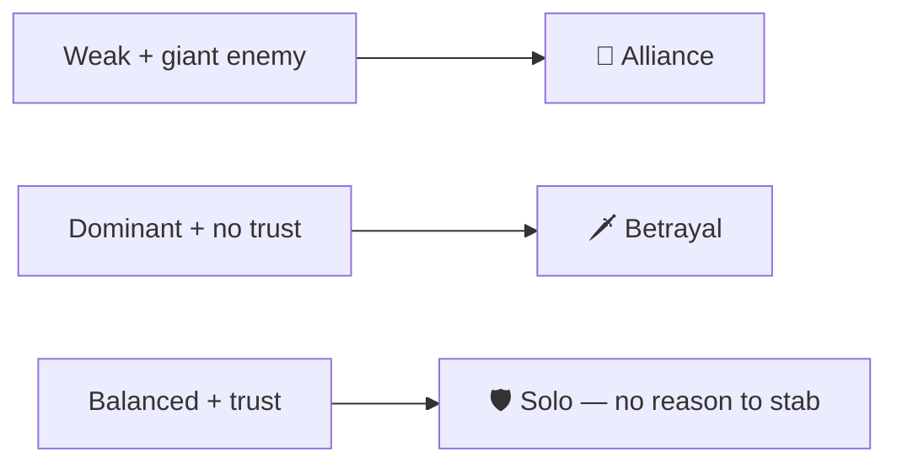

> 💡 **Key Insight** — The same 6 rules produce opposite “personalities” purely from the inputs.

🗣️ **Speaker note:** All values computed by running `evaluate_diplomacy()` from the game code.

---

### Slide 15 – Algorithm 6 · Minimax + Alpha-Beta: Looking Three Moves Ahead (Revised)

**Evaluation function (board score V)**

| Term | Weight | Meaning |
|---|---|---|
| Σ (r + b) of my holds | × 2 | Land: income + defense |
| My armies | × 1.5 | Military |
| My gold | × 0.5 | Treasury |
| Own King’s Landing | + 500 | The throne |
| max(0, 12 − A* cost to throne) | × 1.5 | Closer to the throne (from A*) |
| Σ enemies (Σ r + 1.5 · armies) | − | Enemy power |

$$V = 2\sum(r+b) + 1.5A + 0.5G + 500\,[\text{own KL}] + 1.5\max(0,\,12-\text{cost}) - \sum_{e}\Big(\sum r_e + 1.5A_e\Big)$$

**Search (depth 3)**

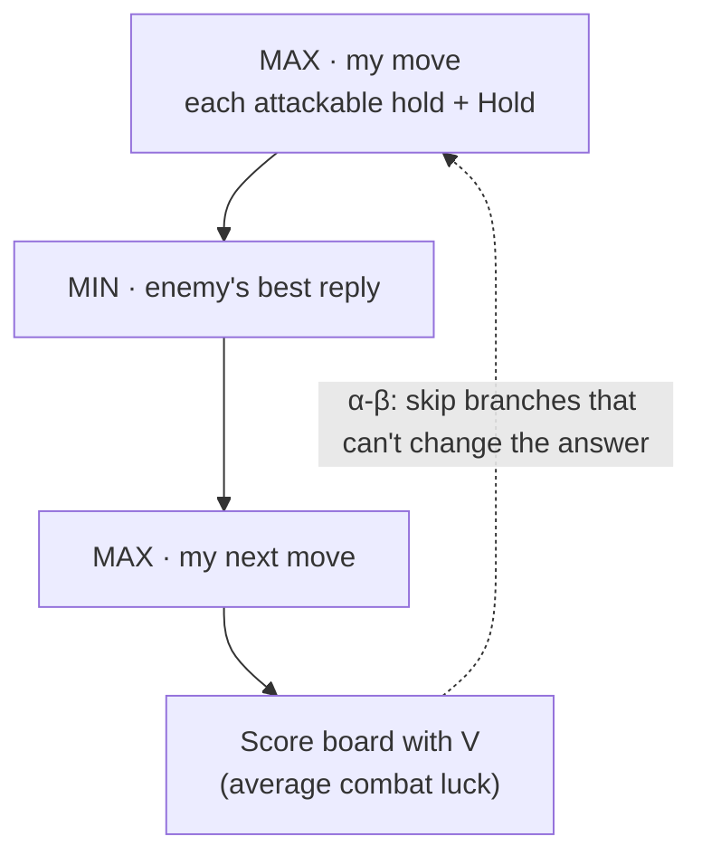

| 📥 Takes | ⚙️ Calculates | 📤 Returns |
|---|---|---|
| All houses, the map, alliances, optional betray target. Depth 3 | My move → enemy’s best reply → my move, scored with V at average luck | A score per attackable hold and for Hold; then one pick, or None (Hold) |

**Two modes**

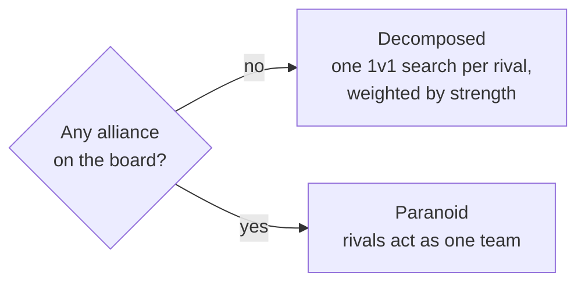

**Safety filters**

| Filter | Rule |
|---|---|
| Allies | Never attack an ally |
| Weak army | Need **5+ armies** to attack a house |
| Throne | Only attack King’s Landing with armies ≥ its effective defense |
| Fast win | Taking the throne ends the search with **+50 per remaining ply** — a sooner win beats a later one |

> ❓ **Why Minimax?** A move must survive the enemy’s best reply. Alpha-beta gives the same answer, faster.

> 🎓 **Exam/Interview Tip** — Alpha-beta never changes the minimax result; with good move ordering it cuts the search from O(b^d) toward O(b^(d/2)).

> ⚠️ **Common Mistake (fixed in this project)** — Sharing α across root moves makes pruned moves report a *bound*, not their true score. Each root move is now searched with a fresh window, so every score shown is exact.

---

### Slide 16 – Minimax · Situations: Which Move, and Why That One? (Revised)

**Pick rule**

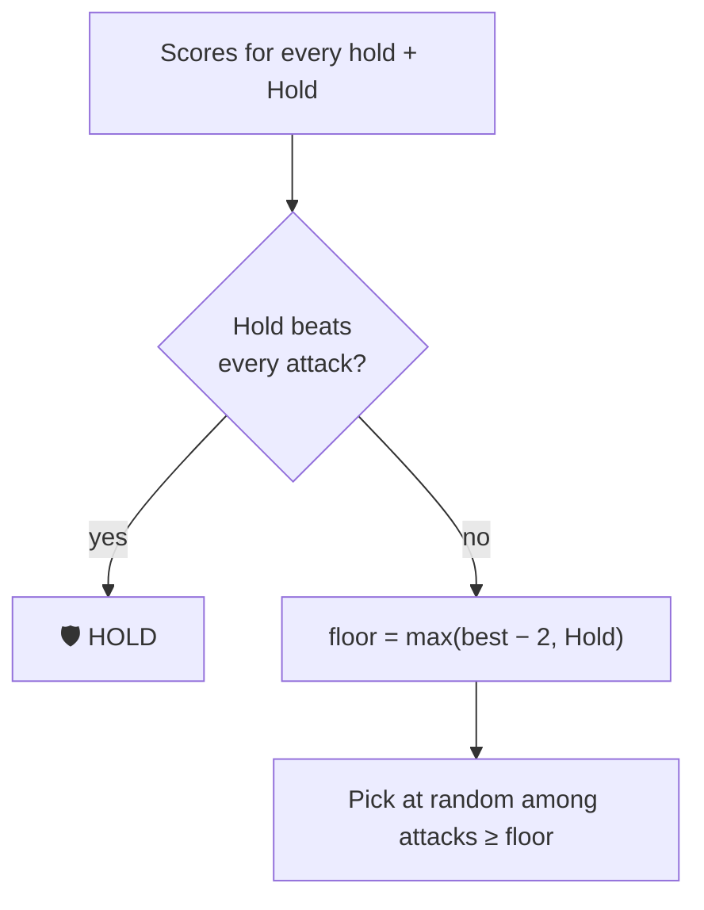

**Situation 1 · Stark, turn 1** (`screenshots/12_human_minimax_hover.jpg`)

| Move | Score | ≥ floor 80.8? |
|---|---:|---|
| **The Twins** | **82.8** | ✅ |
| **The Wall** | **81.5** | ✅ |
| Pyke | 79.5 | ❌ |
| Hold | 69.0 | — |
| Riverrun | 62.1 | ❌ (below Hold) |

floor = max(82.8 − 2, 69) = **80.8** → The Twins or The Wall.
The Twins borders King’s Landing (A* cost 3), so the corridor bonus adds 1.5 × (12 − 3) = **+13.5**.

**Situation 2 · Targaryen, turn 2**

| White Harbor | Dreadfort | Storm’s End | Harrenhal | Hold |
|---:|---:|---:|---:|---:|
| **100** | **100** ✅ picked | 96.5 | 94 | 85.5 |

A tie at the top → Dreadfort chosen at random.

**Situation 3 · Too weak to attack** — every attack scores below Hold → the AI holds and waits for recruits.

> 💡 **Key Insight** — Greedy wanted Riverrun; Minimax ranks it below even Hold because it leads **away** from King’s Landing.

---

### Slide 17 – Algorithm 7 · Monte Carlo Tree Search: 500 Simulated Futures per Decision (Revised)

$$\text{UCT}(a) = \underbrace{\frac{Q(a)}{N(a)}}_{\text{exploit}} + \underbrace{1.414\sqrt{\frac{\ln N_{\text{parent}}}{N(a)}}}_{\text{explore}} + \underbrace{\text{FuzzyBias}(a)}_{\text{instinct}}$$

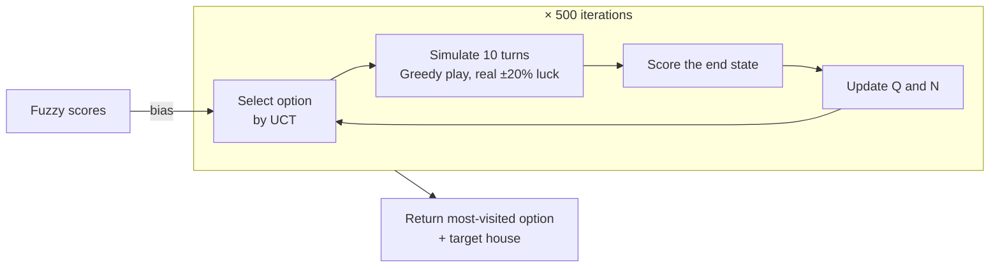

| 📥 Takes | 📤 Returns |
|---|---|
| Game state, fuzzy scores, trust. Options: propose / betray / solo, **or** accept / reject | Most-visited option, plus the target house for a proposal or betrayal |

**Reward at the end of a simulation**

| Outcome | Reward |
|---|---|
| I take the throne | **10** |
| I am eliminated | **0** |
| Otherwise | (0.5·land + 0.3·military + 0.2·income − 0.4·risk) ÷ 100 |
| A rival takes the throne | the above, **halved** |

**Risk inside simulations**

| Event | Effect |
|---|---|
| Alliance breaks each simulated turn | p = 0.25 · (1 − trust/100) → **+10 risk** |
| Betraying first | **+30 risk** |

> ❓ **Why MCTS?** Diplomacy pays off turns later and depends on luck; sampling futures beats hand-written rules.

> 💡 **Key Insight** — Proposals go to the most-trusted rival, ties to the weaker one, so two weaker houses team up against the leader.

---

### Slide 18 – MCTS · Situations: What the Simulations Decided (Revised)

**Situation 1 · Targaryen, turn 2 · Context A**

| Option | Fuzzy bias | Avg Q | Visits |
|---|---:|---:|---:|
| **Solo** | 0.73 | 0.03 | **393** ✅ |
| Propose → Lannister | 0.54 | 0.05 | 107 |

Outcomes were close, so the stronger **solo bias** from Fuzzy Logic tipped it.

**Situation 2 · Lannister, turn 4 · Context B**

| Option | Fuzzy bias | Avg Q | Visits |
|---|---:|---:|---:|
| **Accept Stark** | 0.50 | **2.07** | **496** ✅ |
| Reject | 0.76 | 0.00 | 4 |

Simulations showed allying wins far more often, so it **overruled** a higher reject bias.

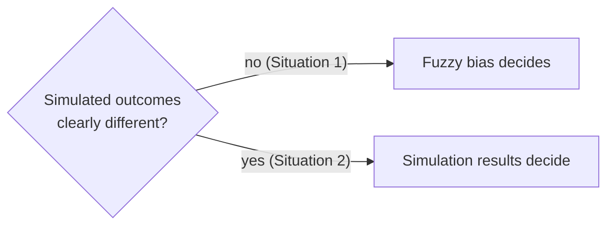

> 💡 **Key Insight** — Fuzzy *steers* the search; MCTS has the final word once the simulated outcomes clearly differ.

🗣️ **Speaker note:** Situation 2 — Lannister (strength 27) received an offer from Stark (29) while Targaryen (32) led, trust 65.

---

## Section 4 — Battle, Economy and Alliance Math

---

### Slide 19 – Battle Math · 1: How Strength Is Calculated (Revised)

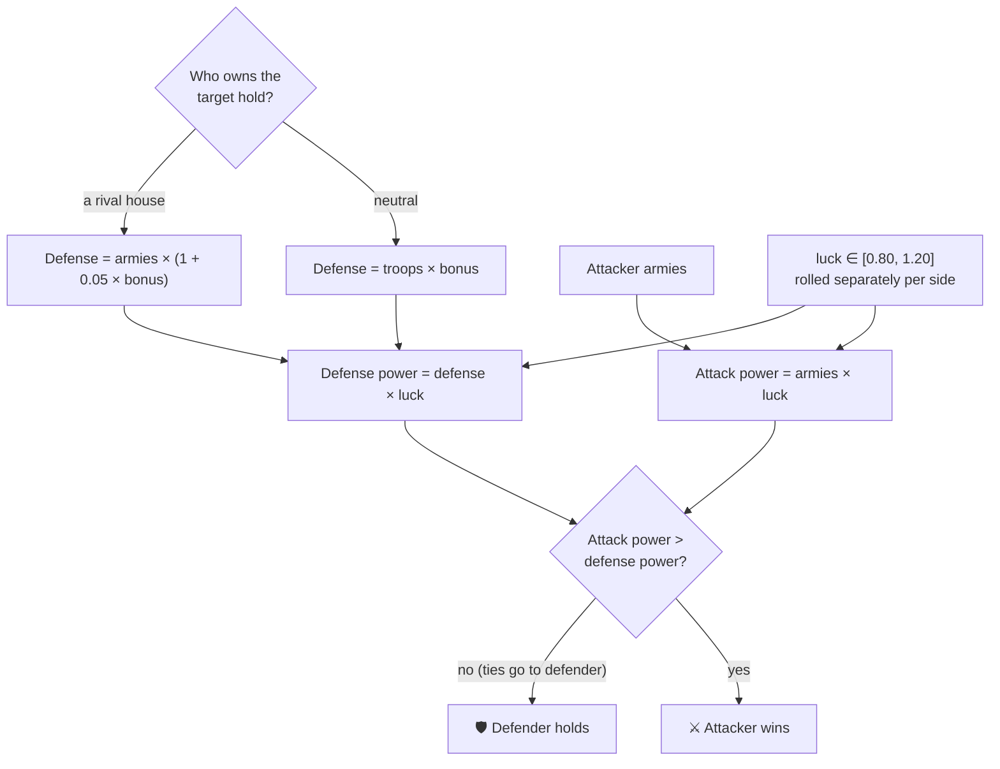

| Example | Calculation | Defense |
|---|---|---:|
| King’s Landing | 11 × 3 | **33** |
| Neutral, 4 troops, bonus 3 | 4 × 3 | **12** |
| House with 20 armies, bonus 2 | 20 × 1.10 | **22** |

> ❓ **Why two formulas?** A neutral garrison is small (2–11), so the full bonus makes castles tough. A house defends with its whole army pool (14–40), so it gets only +5% per level; otherwise house wars would never happen.

> ⚠️ **Common Mistake** — The defense bonus comes from the **hold being attacked**, not the defender’s capital.

---

### Slide 20 – Battle Math · 2: When Is a Win Possible? (Revised)

**Three zones**

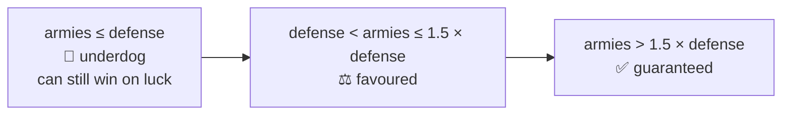

$$\text{Guaranteed: } 0.8 \cdot \text{armies} > 1.2 \cdot \text{defense} \iff \text{armies} > 1.5 \times \text{defense}$$

| Attack | Defense | Win chance | |
|---|---:|---:|---|
| 14 vs neutral 3 (b2) | 6 | **100%** | ██████████ |
| 14 vs neutral 4 (b3) | 12 | 81% | ████████░░ |
| 22 vs house 20 (b2) | 22 | 50% | █████░░░░░ |
| 20 vs house 20 (b3) | 23 | 21% | ██░░░░░░░░ |
| 34 vs King’s Landing | 33 | 57% | ██████░░░░ |
| 40 vs King’s Landing | 33 | 87% | █████████░ |
| 50 vs King’s Landing | 33 | **100%** | ██████████ |

> 🎓 **Exam/Interview Tip** — Equal numbers ≠ even odds: 20 vs 20 is only **21%** because the defender’s bonus raises 20 to 23.

> 💡 **Key Insight** — The AI never even tries King’s Landing with fewer armies than its effective defense.

🗣️ **Speaker note:** Win chances from 200,000 simulated rolls each, using the game’s own `effective_defense()`.

---

### Slide 21 – Battle Math · 3: After the Battle (Revised)

```mermaid
flowchart TD
    B{Battle result} -->|"attacker wins"| AW["Attacker loses ⌊0.5 × D⌋<br/>Defender loses ⌊0.8 × D⌋"]
    B -->|"defender holds"| DH["Attacker loses ⌊0.6 × A⌋<br/>Defender loses ⌊0.2 × min(A, D)⌋"]
    AW --> CAP["Hold changes owner"]
    CAP --> E{"Loser has<br/>0 holds?"}
    E -- yes --> PL["💰 Winner takes all its gold<br/>its pacts and offers are erased"]
    E -- no --> NX[Next house]
    DH --> NX
```

| Result | Attacker loses | Defender loses |
|---|---|---|
| Attacker wins | ⌊0.5 × D⌋ | ⌊0.8 × D⌋ |
| Defender holds | ⌊0.6 × A⌋ | ⌊0.2 × min(A, D)⌋ |

A = attacker’s armies, D = defender’s armies. **Nobody drops below 1 army.**

**Worked example:** 22 Lannister win against 20 Stark → Lannister loses ⌊0.5 × 20⌋ = **10**, Stark loses ⌊0.8 × 20⌋ = **16**.

> ❓ **Why min(A, D)?** A tiny raid of 6 into 20 can only kill 1 defender, so suicide attacks can’t trade 3-for-4.

Visual: `screenshots/06_battle_house.jpg` — turn 6, Lannister’s dragon attacking Stark at Moat Cailin.

---

### Slide 22 – Economy: Why Gold Matters (Revised)

```mermaid
flowchart LR
    H["Holds owned"] --> I["Income<br/>10 + Σ hold income"]
    H --> CAP["Supply cap<br/>10 + 4 × holds"]
    I --> G["Gold"]
    G --> AF["Affordable<br/>⌊(Gold − 15) / 5⌋"]
    CAP --> RM["Room<br/>Cap − Armies"]
    MX["Max 3 per round"] --> RC
    AF --> RC["Recruits = min(3, affordable, room)"]
    RM --> RC
    RC --> AR["Armies"]
    AR -->|"conquer more holds"| H
```

| Rule | Value |
|---|---|
| 1 army costs | 5 gold |
| Always kept in reserve | 15 gold |
| Max recruits per round | 3 |

**Situations**

| Moment | Calculation | Result |
|---|---|---|
| Stark, round 1 | 60 + (10 + 9) = 79 gold, cap = 14 = armies | **0 recruits** — gold alone can’t grow an army |
| After taking 1 hold | cap 18 | **3 recruits** for 15 gold |
| Reaching the throne | King’s Landing defense 33 | needs **6 holds** (cap 34) |

> 💡 **Key Insight** — Land unlocks troops; gold pays for them.

> ❓ **Why a supply cap?** It stops the “camp on one castle and hoard troops” exploit.

🗣️ **Speaker note:** Gold also counts in Minimax (+0.5 per gold) and is plundered when a house is eliminated.

---

### Slide 23 – Diplomacy · 1: Should We Accept This Alliance? (Revised)

```mermaid
sequenceDiagram
    participant P as Proposer (Stark)
    participant I as Inbox
    participant R as Receiver (Lannister)
    participant F as Fuzzy (Context B)
    participant M as MCTS
    P->>I: 🐦 raven: alliance offer (turn N)
    Note over P: still makes its military move
    I->>R: offer read on receiver's next turn
    R->>F: threat = 3rd house · weakness = mine · trust = toward sender
    F->>M: alliance 0.50 · solo 0.76 (bias)
    M->>M: 500 rollouts: accept (allied) vs reject (alone)
    M-->>R: ACCEPT (496 visits) / reject (4)
    R->>P: alliance forms
```

**Situation · Lannister, turn 4**

| Step | Value |
|---|---|
| Own strength 27 → weakness | 32.5 |
| Targaryen (third house) 32 → threat | 80 |
| Trust toward Stark | 65 |
| Fuzzy | alliance 0.50, solo 0.76 |
| MCTS | accept **496** visits (Q 2.07) vs reject 4 (Q 0.00) |
| **Decision** | ✅ **ACCEPT** |

```mermaid
flowchart LR
    S{Offer arrives} --> A{"Only 2 houses left<br/>or sender eliminated?"}
    A -- yes --> RJ["Auto-reject"]
    A -- no --> AL{"Already allied<br/>with someone?"}
    AL -- yes --> BT["Accepting = betraying old ally<br/>−30 trust"]
    AL -- no --> RUN["Fuzzy B → MCTS"]
    BT --> RUN
```

> 🎓 **Exam/Interview Tip** — Context B uses the **third** house as the enemy, so two weaker houses recognise a shared threat.

---

### Slide 24 – Diplomacy · 2: What an Alliance Gives, and What It Costs (Revised)

```mermaid
stateDiagram-v2
    [*] --> Neutral: trust 50
    Neutral --> Proposed: raven sent
    Proposed --> Allied: accepted
    Proposed --> Neutral: rejected
    Allied --> Allied: +5 trust per round
    Allied --> Betrayed: MCTS betray / attack ally's hold / switch ally
    Betrayed --> Neutral: −30 trust
    Allied --> Neutral: partner eliminated
```

| ✅ Benefits | 🔄 AI switch | 🗡️ Betrayal (−30 trust) |
|---|---|---|
| No attacks between allies | All houses move to **Paranoid Minimax** while the pact lasts | MCTS chooses betray |
| Both hit the third house | | Attacking an ally’s hold |
| Trust +5 every round | | Switching to a new ally |

> ⚠️ **Common Mistake** — Allies never share gold or armies.

Visual: `screenshots/09_alliance_formed.jpg` — turn 4, Stark allied with Lannister; panel shows pairwise alliance/betrayal scores and Paranoid mode.

---

## Section 5 — The Complete Flow, Verification and Close

---

### Slide 25 – The Complete Flow: Everything, Step by Step (Revised)

```mermaid
flowchart TD
    classDef scout fill:#3a2f12,stroke:#E0B45E,color:#F3EEE4
    classDef ally fill:#12303a,stroke:#6EC1DC,color:#F3EEE4
    classDef war fill:#3a1d12,stroke:#E8794A,color:#F3EEE4

    START(["Round starts · houses in shuffled order"]) --> NEXT["Next surviving house"]
    NEXT --> INBOX{"Alliance offer<br/>in inbox?"}

    INBOX -- YES --> FB["Fuzzy · Context B<br/>3rd-house threat"]:::ally
    FB --> MB["MCTS<br/>accept / reject"]:::ally
    MB --> DP["Diplomacy<br/>form pact or clear offer"]:::ally

    INBOX -- NO --> SC["BFS + DFS<br/>scout reach"]:::scout
    SC --> FA["Fuzzy · Context A<br/>own landscape"]:::scout
    FA --> MA["MCTS<br/>propose / betray / solo"]:::scout
    MA --> ACT{"Decision?"}
    ACT -- propose --> RV["🐦 Raven to target's inbox"]:::scout
    ACT -- betray --> BR["Break pact · −30 trust<br/>strike former ally"]:::scout
    ACT -- solo --> SO["Continue alone"]:::scout

    DP --> MM
    RV --> MM
    BR --> MM
    SO --> MM

    MM["Minimax<br/>pick target or Hold"]:::war --> HQ{"Hold?"}
    HQ -- yes --> MORE
    HQ -- no --> AS["A*<br/>first border step"]:::war
    AS --> CB["Combat<br/>±20% rolls, losses"]:::war
    CB --> EL["Elimination check<br/>plunder gold · purge pacts"]:::war
    EL --> MORE{"More houses<br/>this round?"}
    MORE -- yes --> NEXT

    MORE -- no --> E1["Income"] --> E2["Recruit<br/>cap · reserve · max 3"] --> E3["+5 trust per pact"] --> E4["Refresh fuzzy"] --> WIN{"Winner?"}
    WIN -- no --> START
    WIN -- yes --> FIN(["🏆 Victory"])
```

> 💡 **Key Insight** — Greedy runs inside every MCTS rollout; it never appears in the top-level flow.

🎬 **Build:** reveal the YES branch, then the NO branch, then the shared military steps, then the end of round.

---

### Slide 26 – Verification: 9 Automated Checks, All Passing (Revised)

| # | Check | Result | |
|---:|---|---|---|
| 1 | BFS | depth 1 → 5 holds, depth 2 → 12 | ✅ |
| 2 | DFS | 64 cycle-free corridors | ✅ |
| 3 | Greedy | picks Riverrun (5 − 2) | ✅ |
| 4 | A* | Winterfell → Twins → KL, cost 6 | ✅ |
| 5 | Fuzzy | extreme cases score as expected | ✅ |
| 6 | Minimax | Decomposed ↔ Paranoid sync | ✅ |
| 7 | MCTS | Contexts A and B, simulation parity | ✅ |
| 8 | Game rules | defense, supply cap, purge | ✅ |
| 9 | 8 AI games | wins 3 · 3 · 2, avg 15.5 turns, 79 house-vs-house battles | ✅ |

```mermaid
pie title Wins in 8 simulated AI games
    "Stark" : 3
    "Targaryen" : 3
    "Lannister" : 2
```

> 🎓 **Exam/Interview Tip** — Run it yourself: `python test_algorithms.py`.

> 💡 **Key Insight** — 79 house-vs-house battles prove the AIs really fight each other, not just neutral holds.

---

### Slide 27 – Closing: Winter Is Coming. So Is the AI. (Revised)

| Technique | Algorithm(s) |
|---|---|
| Search | BFS · DFS · Greedy · A* |
| Fuzzy reasoning | Mamdani Fuzzy Logic |
| Adversarial planning | Minimax + Alpha-Beta |
| Simulation | Monte Carlo Tree Search |

**Thank you · Questions?**

Background: `clips/win_all_territories.jpg` — a Human vs AI game where Lannister took 17 of 19 holds.

🗣️ **Speaker note:** Offer a live demo: `python main.py`, AI vs AI, press Space to advance.
